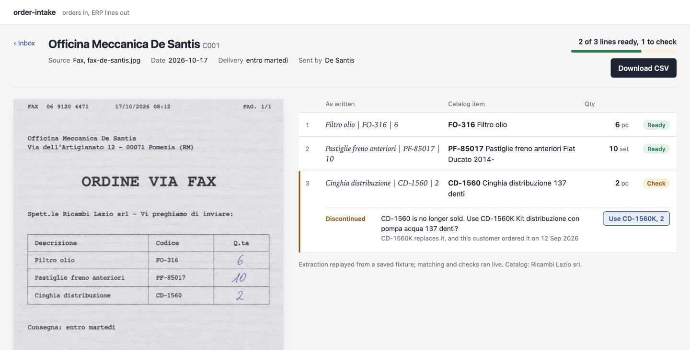

# order-intake

Wholesale distributors still get most of their orders as faxes, phone photos of
handwritten notes, PDFs, spreadsheets, emails and WhatsApp messages. Somebody
reads each one and types it into the ERP, line by line.

order-intake reads the order, matches every line against the distributor's own
catalog and the customer's order history, and sends only the doubtful lines to
a person, with a suggested fix next to each one.



## What it catches

All of these are in the sample inboxes, so you can see them without an API key:

| The order says | What happens |
| --- | --- |
| `CD-1560` (discontinued) | Suggests `CD-1560K`, the replacement in the catalog, and mentions this customer already bought it on 12 Sep |
| `FO-3l6` | Code doesn't exist; flags it as a typo of `FO-316` |
| `le solite scatole 503` ("the usual boxes") | No quantity, so it proposes 40, the customer's median over the last three orders (40, 40, 50) |
| `200 m cavo FS17 2,5 blu` | Cable is sold in 100 m coils: becomes 2 coils |
| `60 iridium spark plugs` | This customer usually orders 8. Flags it instead of shipping 60 |
| `Detergente pavimenti … 7,50` | List price is €8.20; notes that €7.50 was the price before the last update |
| `2 wiper blades 650mm` | Not in the catalog. Says so and shows the closest item, but does not pick it |
| `2 x engine oil 5W-30 5L` in an English email | Matches `LT-5W30-5 Olio motore 5W-30 5 L` in an Italian catalog, not the 1 L can next to it |

Lines that pass every check are marked ready and go straight to the CSV.

## Try it

Needs Python 3.11+ and [uv](https://docs.astral.sh/uv/).

```sh
make install
make demo      # every sample through the pipeline, in the terminal
make serve     # review screen on http://127.0.0.1:8000
```

Both run offline. The extraction step is replayed from `samples/*/fixtures`;
matching, checks and export run for real.

To read your own files, set `ANTHROPIC_API_KEY` (see `.env.example`) and:

```sh
.venv/bin/intake run path/to/order.pdf -w samples/ricambi-lazio --csv lines.csv
.venv/bin/intake serve    # adds an upload form
```

## How it works

```
file ─► sources.py ─► extract.py ─► matching.py ─► rules.py ─► review / CSV
        fax, photo,    Claude reads   catalog codes,   discontinued, units,
        PDF, xlsx,     the order as   aliases, fuzzy   usual quantities,
        eml, text      written        descriptions     prices, legibility
```

The split matters more than anything else in the repo.

**The model only transcribes.** It gets the document and a schema
(`ExtractedOrder` in `models.py`) and is told to copy codes character by
character, typos included, and to leave a quantity empty rather than guess it.
It never sees the catalog. That keeps the prompt short, and it means a
plausible-looking code the model invented can't slip through as a match.

**Everything that needs judgement is plain Python.** Matching a line to an
item, converting metres to coils, deciding that 60 is too many: each of those
is a small function you can read, test and argue with. When a line is flagged,
the reason is a sentence a warehouse clerk understands, not a confidence score.

**Unsure means a person decides.** A match under 90/100, two candidates within
a few points of each other, low legibility: each of these stops the line. A
sender that doesn't match any customer stops the whole order. The goal is
fewer lines to check, not zero.

Extraction uses structured outputs (`client.beta.messages.parse` with a
Pydantic model). A refusal or a truncated response is raised as an error,
never turned into an empty order.

## Your own data

A workspace is a folder of CSV files that any ERP can export:

```
workspace.json   {"seller": "Ricambi Lazio srl", "currency": "EUR"}
catalog.csv      code, name, aliases, unit, content_qty, content_unit,
                 price, previous_price, status, replaced_by
customers.csv    id, name, aliases, email, fax
history.csv      date, customer_id, code, qty
inbox/           orders to process (only used by the demo and the web UI)
```

`aliases` holds the names customers actually use, separated by `|`
(`filtro olio motore|oil filter`). Adding a few for the items that get
misread is usually the cheapest accuracy gain there is.

The CSV export has one row per line with `status` set to `ok` or `review`,
ready for an ERP import or a person.

## Layout

```
intake/
  sources.py    load images, PDFs, xlsx, eml (with attachments), text
  extract.py    Claude extraction + fixture replay
  matching.py   normalisation and catalog matching
  units.py      unit aliases and pack conversions
  rules.py      the checks, one function each
  pipeline.py   customer lookup, then match + checks per line
  web/          FastAPI review screen
samples/        three made-up distributors with catalogs, history and inboxes
tests/
```

```sh
make test
```

## Limits

- The samples are invented and the fixtures were written by hand to match the
  extraction schema. They show what the pipeline does with an extraction; they
  are not a measurement of extraction accuracy on real orders.
- Results live in memory. There is no ERP connector, only the CSV.
- Matching is tuned for Italian and English item names. Other languages need
  aliases or a better stemmer.

## License

MIT
